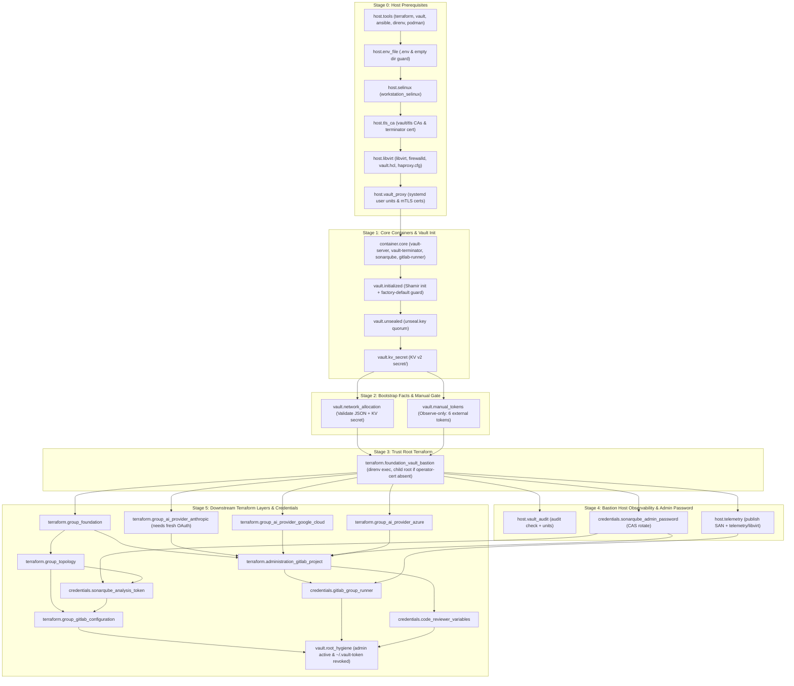

# Parent Group Governance

This repository is the upstream governance root for a single developer workstation. Four planes reside in this repository:

1. host SELinux and networking prerequisites
2. rootless Podman services
3. the Bastion Vault trust root
4. the GitLab group topology under `csning1998-lab`.

The Go command line binary `governance` (`tools/governance/`) is the single runtime entry point for workstation operations.

## Section 1. Scope and Prerequisites

### Item A. Ownership Boundary and Layout

This repository owns six infrastructure assets:

- The workstation SELinux policy modules and the persistent file context registry covering local repositories on the host.
- The Bastion Vault instance acting as the trust root for every downstream platform repository.
- The host prerequisites of Bastion Vault: the `vault-bastion-publish` libvirt network, `virtnetworkd.service` startup ordering, firewalld host isolation policies, and unlimited operator `memlock` limits.
- The operator Vault Proxies on the host, one systemd user unit per identity declared in `workstation-topology.yaml`.
- The GitLab group topology under `csning1998-lab`, including group labels, plain CI variables, the shared runner, and the SonarQube analysis token.
- The `governance` CLI compiled from `tools/governance/`.

Downstream platform repositories consume the Bastion Vault instance and the GitLab topology declared in this repository. Downstream repositories MUST NOT redeclare either asset.

| Path                        | Contents                                                                                      |
| --------------------------- | --------------------------------------------------------------------------------------------- |
| `ansible/`                  | `workstation_*` roles, local inventory with `group_vars/all/` projections, and host playbooks |
| `documentation/`            | Topology specifications, privilege convergence architecture, token matrix, and build notes    |
| `terraform/layers/`         | Eight independently applied Terraform layers, each backed by a dedicated GitLab HTTP state    |
| `terraform/modules/`        | Shared Terraform provisioner modules consumed by governance and downstream layers             |
| `tools/governance/`         | Go source and design documentation for the `governance` CLI                                   |
| `vault/`                    | `vault/terminator/Containerfile` plus runtime Vault configuration, Raft data, TLS, and keys   |
| `compose.yml`               | Rootless Podman container service declarations                                                |
| `workstation-topology.yaml` | Single declarative topology for Vault listeners, Vault Proxies, telemetry, and credentials    |
| `.githooks/`                | Local `pre-commit` (gitleaks) and `commit-msg` (commitlint) container hooks                   |
| `.gitlab/`                  | CODEOWNERS, merge request templates, linter settings, reviewer config, and versioning schema  |

Runtime state paths are excluded from version control: `vault/data/`, `vault/keys/`, `vault/tls/`, `vault/audit/`, rendered files under `vault/`, `sonarqube/`, `gitlab-runner-configs/`, `.env`, `network-allocation.json`, and the compiled `governance` binary.

### Item B. Host Prerequisites and Deployment Inputs

Three binaries MUST resolve on `PATH` before any bootstrap step executes: `terraform`, `vault`, and `ansible`. Rootless Podman MUST be active under the operator account because the GitLab runner communicates through `/run/user/<uid>/podman/podman.sock`. The host MUST boot with Secure Boot enabled because `workstation_libvirt` refuses hosts without Secure Boot prior to configuring the trust root.

Prepare the local tooling from the repository root:

```bash
cd "$(git rev-parse --show-toplevel)"
ansible-galaxy collection install -r ansible/requirements.yaml
(cd tools/governance && go build -o ../../governance ./cmd/governance)
./governance host verify
```

Cloud provider CLIs (`ant`, `gcloud`, and `az`) are optional and remain outside `./governance host verify`. Install the optional CLIs through `workstation_cloud_cli` when managing AI or cloud Workload Identity Federation layers, consulting `terraform/layers/group-ai-provider-*/README.md` for provider credentials:

```bash
(cd ansible && ansible-playbook playbooks/workstation_cloud_cli.yaml --ask-become-pass)
```

Create the ignored deployment allocation file from the checked in example before bootstrap begins:

```bash
cp terraform/layers/foundation-vault-bastion/network-allocation.example.json \
    terraform/layers/foundation-vault-bastion/network-allocation.json
```

Replace every example value in `network-allocation.json` with deployment values. Every value MUST be a string because KV version 2 stores flat string fields. `foundation-vault-bastion` rejects any missing field, malformed CIDR, or overlapping pool through Terraform preconditions.

| Field                  | Purpose                                                                                                                                                                     | Example            |
| ---------------------- | --------------------------------------------------------------------------------------------------------------------------------------------------------------------------- | ------------------ |
| `domain_suffix`        | Base DNS domain for platform services                                                                                                                                       | `example.internal` |
| `stages`               | JSON array of DNS stage labels, one SPIRE trust domain per stage                                                                                                            | `["production"]`   |
| `network_cidr`         | Primary IPv4 `/16` supernet for the platform                                                                                                                                | `10.20.0.0/16`     |
| `bastion_publish_cidr` | Segment 0 IPv4 CIDR inside `network_cidr` hosting the Bastion Vault publish listener                                                                                        | `10.20.0.0/24`     |
| `pod_network_cidr`     | IPv4 pool supplying Kubernetes pod networks, disjoint from `network_cidr` and `service_network_cidr`                                                                        | `10.64.0.0/10`     |
| `service_network_cidr` | IPv4 pool supplying Kubernetes service networks, disjoint from `network_cidr` and `pod_network_cidr`                                                                        | `10.128.0.0/12`    |
| `network_baseline`     | JSON object declaring `host_vip_offset`, `global_mac_prefix`, `global_mtu`, `global_mss`, `node_exporter_port`, `cidr_subnet_bits`, `cidr_nat_offset`, and `cidr_index_max` | (Shown below)      |

The JSON object declaring of `network_baseline` is shown below:

```json
{
    "host_vip_offset": 250,
    "global_mac_prefix": "52:54:00",
    "global_mtu": 1450,
    "global_mss": 1360,
    "node_exporter_port": 9100,
    "cidr_subnet_bits": 8,
    "cidr_nat_offset": 124,
    "cidr_index_max": 248
}
```

Prepare the six external GitLab, Anthropic, and GitHub tokens documented in `documentation/fine-grained-token-matrix.md` prior to Section 2.

## Section 2. Greenfield Bootstrap

All commands in this section follow a single linear dependency sequence assuming Section 1 prerequisites are satisfied. Alternatively, run `./governance status [--deep]` and `./governance converge [--to <stage|node>]` to observe and drive the Stage 0 to Stage 5 convergence DAG automatically.



### Step A. Host Convergence and Bastion Vault Initialization

1. Apply host prerequisites before starting the core containers:

    ```bash
    cd "$(git rev-parse --show-toplevel)"
    ./governance host apply-all
    podman compose up -d
    ```

    `host apply-all` executes four stages under one privilege escalation prompt:
    1. SELinux confinement, local CA generation under `vault/tls/` when absent
    2. libvirt and firewalld configuration with `vault/vault.hcl` and HAProxy templates
    3. operator Vault Proxy user units.
    4. `podman compose up -d` creates missing bind mount directories under `sonarqube/` and `vault/`, inheriting `container_file_t` from the repository root.

2. Initialize Bastion Vault with the KV version 2 engine mounted at `secret`:

    ```bash
    ./governance vault init
    ./governance vault enable-kv
    ```

    `vault init` waits for every service declared in `service_admin_passwords` and aborts when a live service rejects the factory default password, preventing an orphaned database after a Vault reset. When rebuilding Bastion Vault against a retained SonarQube volume, empty the SonarQube volumes before executing `vault init`:

    ```bash
    podman compose stop sonarqube sonarqube-db
    podman unshare find sonarqube/data sonarqube/postgres-data -mindepth 1 -delete
    podman compose up -d
    ```

3. Seed `network-allocation.json` and the six external tokens against loopback `127.0.0.1:8200` with the root token in `~/.vault-token`. Verify `vault-proxy-env root` after the writes complete:

    ```bash
    cd "$(git rev-parse --show-toplevel)"
    export VAULT_ADDR="https://127.0.0.1:8200"
    export VAULT_CACERT="$HOME/.config/vault-proxy/ca.pem"
    unset VAULT_TOKEN VAULT_CLIENT_CERT VAULT_CLIENT_KEY

    put_secret() {
        printf '%s %s: ' "$1" "$2" && read -rs secret_value && echo
        printf '%s' "$secret_value" | vault kv put -mount=secret "$1" "$2=-"
        unset secret_value
    }

    vault kv put \
        secret/parent-group-governance/network/allocation \
        @terraform/layers/foundation-vault-bastion/network-allocation.json

    put_secret parent-group-governance/terraform/state-backend token
    put_secret parent-group-governance/ai-provider-console/anthropic anthropic_admin_api_key
    put_secret parent-group-governance/github/publication deploy_token
    put_secret gitlab-ci-with-code-reviewer/terraform/state-backend token
    put_secret gitlab-ci-with-code-reviewer/integration/code-reviewer-bot token
    put_secret gitlab-ci-with-code-reviewer/integration/auto-version-tag-bot token

    vault-proxy-env root >/dev/null
    ```

    Direct `VAULT_ADDR` exports precede `vault-proxy-env root` because `vault-proxy-env root` requires `secret/parent-group-governance/terraform/state-backend` to exist prior to invocation. `put_secret` writes stdin values without echo or trailing newlines, keeping secrets out of shell history and `/proc/<pid>/cmdline`.

### Step B. Foundation Apply, Host Telemetry, and Downstream Convergence

1. Bootstrap `foundation-vault-bastion` in a dedicated subshell setting `VAULT_PROXY_IDENTITY=root` so the identity override never leaks into the parent shell:

    ```bash
    cd "$(git rev-parse --show-toplevel)"
    direnv allow terraform
    (
        cd terraform/layers/foundation-vault-bastion
        direnv allow .
        export VAULT_PROXY_IDENTITY=root
        terraform init
        terraform apply
    )
    ```

    Setting `VAULT_PROXY_IDENTITY=root` inside the subshell overrides the default `administrator` identity in `terraform/.envrc` until `foundation-vault-bastion` creates the `operator-cert` mount and per identity cert roles. After the apply finishes, background Vault Proxies authenticate automatically within `workstation_vault_proxy_login_retry_seconds`. All subsequent applies execute as `administrator`.

2. Converge the Vault audit check and the host telemetry scrape network. Reload the TLS terminators afterward:

    ```bash
    cd "$(git rev-parse --show-toplevel)"
    ./governance host apply-vault-audit
    ./governance host apply-host-telemetry
    podman compose restart vault-terminator
    podman compose --profile host-telemetry up -d vault-telemetry-terminator
    ```

    `host apply-host-telemetry` ensures `vault/tls/publish.pem` covers the scrape IP read from `registry/platform/network/allocation`. The command then executes `playbooks/workstation_host_telemetry.yaml` followed by `playbooks/workstation_libvirt.yaml` under one privilege escalation prompt. `vault-telemetry-terminator` uses the `host-telemetry` profile because starting the container before `vault/terminator/haproxy-telemetry.cfg` exists would cause Podman to create an empty directory at the mount path.

3. Rotate the SonarQube administrator password before allowing the `administration-gitlab-project` direnv file:

    ```bash
    ./governance credentials rotate sonarqube-admin-password
    direnv allow terraform/layers/administration-gitlab-project
    ```

    Interactive login to `http://127.0.0.1:9000` MUST pipe the rotated password directly to the clipboard without printing to standard output:

    ```bash
    eval "$(vault-proxy-env administrator)"
    vault kv get -mount=secret -field=sonarqube_admin_password \
        parent-group-governance/sonarqube/admin-account | tr -d '\n' | xclip -selection clipboard
    ```

4. Refresh the short lived Anthropic OAuth access token (valid for minutes) before applying `group-ai-provider-anthropic` or `administration-gitlab-project`:

    ```bash
    ant auth login --profile issuer-gitlab-saas --scope "org:admin"
    eval "$(vault-proxy-env administrator)"
    ant auth print-credentials --profile issuer-gitlab-saas --access-token | tr -d '\n' | \
        vault kv patch -mount=secret -method=rw parent-group-governance/ai-provider-console/anthropic \
            anthropic_oauth_access_token=-
    ```

5. Apply the remaining Terraform layers in upstream dependency order alongside service credential issuance:

    ```bash
    for layer in \
        terraform/layers/group-foundation \
        terraform/layers/group-ai-provider-anthropic \
        terraform/layers/group-ai-provider-google-cloud \
        terraform/layers/group-ai-provider-azure \
        terraform/layers/administration-gitlab-project \
        terraform/layers/group-topology; do
        (cd "$layer" && direnv allow . && direnv exec . /bin/sh -c 'terraform init && terraform apply')
    done

    ./governance credentials issue gitlab-group-runner
    podman compose restart gitlab-runner
    ./governance credentials issue sonarqube-analysis-token
    (cd terraform/layers/group-gitlab-configuration && direnv allow . && direnv exec . /bin/sh -c 'terraform init && terraform apply')
    ./governance credentials issue code-reviewer-variables
    ```

6. Revoke the bootstrap root token once the `administrator` Vault Proxy login is active:

    ```bash
    ./governance vault revoke-root
    ```

## Section 3. Host Runtime and Security

### Item A. SELinux Confinement and Diagnostics

Every container in `compose.yml` operates under rootless Podman with SELinux in enforcing mode. Four conventions apply across all services:

- Volume mounts MUST NOT declare `:z` or `:Z` relabel flags. Recursive relabeling rewrites MCS categories on sibling directories and can trigger Raft write denials in Bastion Vault.
- Continuous services MUST NOT declare `security_opt: label=disable`.
- Every host bind mount path MUST be registered through `semanage fcontext` as `container_file_t:s0` without MCS categories, using `workstation_selinux_fcontext_present` in `ansible/roles/workstation_selinux/defaults/main.yaml` as the single registry.
- Services accessing the rootless Podman API socket MUST declare `label=type:container_engine_t`.

The local policy modules under `ansible/roles/workstation_selinux/files/` grant `process2 nnp_transition` across `unconfined_t`, `container_runtime_t`, and `iptables_t`, PTY access for `pasta_t` and netavark helpers, and `container_engine_t` socket writes on `user_tmp_t`. `workstation_selinux` converges five targets: updated SELinux policy modules, anchored fcontext registrations, drifted inode labels via `restorecon -RF` (required because `container_file_t` appears in `/etc/selinux/targeted/contexts/customizable_types`), the default `etc_t` label on `/etc/fstab`, and removal of unanchored legacy patterns.

Verify container confinement, file labels, and Podman socket access:

```bash
for c in parent-group-governance-vault-bastion parent-group-governance-sonarqube-postgres \
        parent-group-governance-sonarqube parent-group-governance-gitlab-runner; do
    printf '%s\t' "$c"
    podman inspect "$c" --format '{{.ProcessLabel}}'
done
ls -RZ .gitleaks.toml vault sonarqube gitlab-runner-configs | grep -o 'container_file_t:s0[^ ]*' | sort -u
matchpathcon .gitleaks.toml vault/data sonarqube/data gitlab-runner-configs
ls -Z /etc/fstab
podman exec parent-group-governance-gitlab-runner \
    curl -s -o /dev/null -w '%{http_code}\n' \
    --unix-socket /run/podman/podman.sock http://d/v1.41/_ping
```

Diagnose container AVC denials with:

```bash
sudo ausearch -m avc -ts recent | grep 'scontext=system_u:system_r:container'
```

- Denials from `pasta_t` targeting `config_home_t` or `data_home_t` stem from inherited terminal file descriptors and do not affect container workloads.
- Non empty MCS categories in `tcontext` on a bind mount path indicate external relabel drift; reapplying `./governance host apply-selinux` restores `container_file_t:s0`.
- Denials targeting `container_runtime_t` on `unix_stream_socket` `connectto` indicate a missing policy module or a container missing `container_engine_t`.
- Denials targeting `unlabeled_t` on `/etc/fstab` MUST be resolved by restoring `etc_t` through `./governance host apply-selinux`, never by generating a local allow module.

Because `semanage fcontext` binds literal filesystem paths, relocating the repository requires updating `workstation_selinux_fcontext_present` and `workstation_selinux_fcontext_absent` in `ansible/roles/workstation_selinux/defaults/main.yaml` before executing `./governance host apply-selinux` prior to recreating containers or invoking `restorecon`.

### Item B. Container Services, Vault Terminators, and Host Networking

| Service                      | Image                                       | Network                                  | Notes                                                                    |
| ---------------------------- | ------------------------------------------- | ---------------------------------------- | ------------------------------------------------------------------------ |
| `vault-server`               | `hashicorp/vault:2.2.0`                     | Host namespace                           | Loopback listeners as `HOST_UID:HOST_GID` with `IPC_LOCK` and Raft store |
| `vault-terminator`           | Built from `vault/terminator/Containerfile` | Host namespace                           | HAProxy 3.2 TLS 1.3 terminator on `publish_ip`                           |
| `vault-telemetry-terminator` | Built from `vault/terminator/Containerfile` | Host namespace                           | Profile `host-telemetry`; HAProxy metrics frontend on `scrape_ip`        |
| `gitlab-runner`              | `gitlab/gitlab-runner:v19.0.1`              | Host namespace                           | Declares `label=type:container_engine_t` and mounts Podman API socket    |
| `sonarqube`                  | `sonarqube:26.7.0.124771-community`         | `sonarqube-internal`, `sonarqube-ci-net` | Published on `127.0.0.1:9000` alone                                      |
| `sonarqube-db`               | `postgres:18-alpine3.24`                    | `sonarqube-internal`                     | Password supplied via `SONARQUBE_DB_PASSWORD` in `.env`                  |
| `commitlint`                 | Reviewer image from CI component `1.8.6`    | Default                                  | Ephemeral container invoked by `.githooks/commit-msg`                    |
| `gitleaks`                   | `zricethezav/gitleaks:v8.30.1`              | Default                                  | Ephemeral container invoked by `.githooks/pre-commit`                    |

`sonarqube-ci-net` uses a literal bridge name because the GitLab runner configuration sets `network_mode = "sonarqube-ci-net"`, letting CI jobs reach SonarQube without exposing a host port.

`workstation_libvirt` renders `vault/vault.hcl`, `vault/vault.env`, `vault/terminator/haproxy.cfg`, and `vault/terminator/terminator.env` from `group_vars/all/` projections of `workstation-topology.yaml`. Every Vault TCP listener binds loopback `127.0.0.1`:

- `api_port` (`8200`) serves local CLI, Terraform, and Vault Proxy clients with the ML-DSA-87 CA chain.
- `publish_backend_port` (`8204`) accepts PROXY protocol v2 (`proxy_protocol_behavior = "use_always"`) and enforces `tls_require_and_verify_client_cert` against `terminator-client.pem`, preventing loopback processes from forging client source addresses.
- `metrics_port` (`8202`) enables `unauthenticated_metrics_access`; port `8203` remains unused because Vault reserves one port above each API listener for cluster traffic.

`vault-terminator` binds `publish_ip:8200` with TLS 1.3 curves `MLKEM1024:SecP384r1MLKEM1024` and the EC P-384 `publish.pem` certificate, forwarding in TCP mode with `send-proxy-v2` to preserve guest source IP addresses for AppRole CIDR checks. The terminator frontend on `publish_ip:8202` admits `GET /v1/sys/metrics` alone. Container startup polls for `TERMINATOR_PUBLISH_IP` before launching HAProxy, and `init: true` ensures prompt `SIGTERM` handling. Listener or `vault/tls/` changes take effect after restarting `vault-server` and `vault-terminator`.

`workstation_libvirt` also establishes four host prerequisites: enabling `virtnetworkd.service` with a systemd drop in ordered after firewalld (ensuring libvirt attaches autostarted bridges into firewall zones at boot), creating the `vault-bastion-publish` (`172.16.0.0/24`) bridge, overriding `/etc/firewalld/policies/libvirt-to-host.xml` (priority `-1`, target `REJECT`, admitting DHCP, DNS, ICMP, and TCP `8200` from `172.16.0.0/24` while dropping `ssh`, `tftp`, and scrape ports) plus `/etc/firewalld/zones/libvirt.xml`, and asserting zero bindings in firewalld zone `trusted`. Secure Boot MUST remain enabled because `workstation-backup` binds disk encryption keys to TPM PCR 7.

`workstation_host_telemetry` establishes three host artifacts: the `host-telemetry-scrape` bridge (third octet `249`, ADR-143), firewalld policy `host-telemetry-to-host` (priority `-2`, target `CONTINUE`, admitting `vault_bastion.metrics_port` and `host_telemetry_scrape.host_exporter_ports` prior to `libvirt-to-host`), and the local fact `/etc/ansible/facts.d/host_telemetry.fact` storing `scrape_ip` for subsequent `workstation_libvirt` executions. Regenerating `vault/tls/` with `./governance vault generate-tls` drops the scrape IP SAN and requires executing `./governance host apply-host-telemetry` again.

## Section 4. Governance CLI and Terraform Layers

### Item A. CLI Surface, Environment File, and Root Token Lifecycle

Invoking `./governance` without arguments opens an interactive menu; invoking a subcommand executes the same Go operation function directly for scripted workflows.

| Subcommand                                                   | Effect                                                                           |
| ------------------------------------------------------------ | -------------------------------------------------------------------------------- |
| `status [--deep] [--to <stage\|node>]`                       | Observes the Stage 0 to Stage 5 DAG and prints each node's convergence state     |
| `converge [--to <stage\|node>] [--dry-run] [--auto-approve]` | Converges absent and drifted nodes along the unblocked DAG subgraph              |
| `host apply-all`                                             | Applies SELinux, local CA when absent, libvirt, and Vault Proxies in one prompt  |
| `host verify`                                                | Verifies `terraform`, `vault`, and `ansible` on `PATH`                           |
| `host apply-selinux`                                         | Applies `playbooks/workstation_selinux.yaml`                                     |
| `host apply-libvirt`                                         | Applies `playbooks/workstation_libvirt.yaml`                                     |
| `host apply-vault-proxy`                                     | Applies `playbooks/workstation_vault_proxy.yaml`                                 |
| `host apply-vault-audit`                                     | Applies `playbooks/workstation_vault_audit.yaml` without privilege escalation    |
| `host apply-host-telemetry`                                  | Covers publish SAN if needed, then chains telemetry and libvirt playbooks        |
| `vault generate-tls`                                         | Clears `vault/tls/` and generates local CAs, listener certs, and terminator cert |
| `vault init`                                                 | Verifies factory default passwords, initializes Vault, and unseals Vault         |
| `vault enable-kv`                                            | Mounts the KV version 2 engine at `secret`                                       |
| `vault unseal`                                               | Unseals Bastion Vault with `vault/keys/unseal.key`                               |
| `vault revoke-root`                                          | Revokes the root token once the `administrator` Proxy login is verified          |
| `vault generate-root`                                        | Generates a break glass root token into `~/.vault-token` from `unseal.key`       |
| `credentials rotate <key>`                                   | Rotates a declared service admin password via CAS staging in Bastion Vault       |
| `credentials reconcile <key>`                                | Applies the Vault stored password to a drifted live service                      |
| `credentials issue sonarqube-analysis-token`                 | Issues global SonarQube token to Vault and `SONAR_TOKEN`, revoking older tokens  |
| `credentials issue gitlab-group-runner`                      | Registers the shared runner and writes `gitlab-runner-configs/config.toml`       |
| `credentials issue code-reviewer-variables`                  | Writes bot tokens into CI variables of all `code_reviewer_variable_projects`     |
| `terraform audit-state [--history]`                          | Audits Terraform remote state snapshots for leaked credentials                   |

Every subcommand bootstraps `.env` atomically (mode `0600`) with six keys: `PROJECT_ROOT`, `HOST_UID`, `HOST_GID`, `UNAME`, `UHOME`, and a randomly generated `SONARQUBE_DB_PASSWORD`. If `.env` lacks `SONARQUBE_DB_PASSWORD` while `sonarqube/postgres-data` is non empty or unreadable, bootstrap aborts to prevent overwriting the database credential. An empty `sonarqube/postgres-data` directory permits generating a new password.

The root token in `~/.vault-token` serves bootstrap and break glass recovery alone. `vault.hcl` enables `enable_unauthenticated_access = ["generate-root"]` because Vault 2 authenticates `generate-root` endpoints by default, allowing unseal key quorum recovery when operator identities are unavailable. Break glass sessions MUST conclude with `./governance vault revoke-root`. The full CAS rotation state machine and state audit design reside in `tools/governance/README.md`.

### Item B. Terraform Layers, Vault Proxies, and CLI Issued Credentials

Every Terraform layer stores remote state in the GitLab HTTP backend without hardcoding backend addresses. `terraform/.envrc` invokes `vault-proxy-env "${VAULT_PROXY_IDENTITY:-administrator}"` to export `VAULT_*`, `TF_HTTP_*`, `GITLAB_TERRAFORM_STATE_BASE`, `TF_VAR_gitlab_url`, and `TF_VAR_gitlab_top_level_group_path`; `terraform/layers/administration-gitlab-project/.envrc` selects `credential-distributor-parent-group-governance`. Detailed Proxy identity tiers, mTLS certificate rotation, and Web UI login rules reside in `documentation/workstation-topology-specification.md` and `documentation/architecture/bastion-vault-privilege-convergence.md`.

| Layer                            | Responsibility                                                                      | Vault Proxy Identity                             | Upstream State                                                                                                 |
| -------------------------------- | ----------------------------------------------------------------------------------- | ------------------------------------------------ | -------------------------------------------------------------------------------------------------------------- |
| `foundation-vault-bastion`       | Root and constrained intermediate PKI, `operator-cert` roles, ACLs, registry, audit | `root` (bootstrap), `administrator` (day 2)      | None                                                                                                           |
| `group-foundation`               | Top level GitLab group at `var.gitlab_top_level_group_path`                         | `administrator`                                  | None                                                                                                           |
| `group-ai-provider-anthropic`    | Organization level Anthropic WIF OIDC issuer (`issuer-gitlab-saas`)                 | `administrator`                                  | None                                                                                                           |
| `group-ai-provider-google-cloud` | Google Cloud WIF workload identity pool and provider                                | `administrator`                                  | None                                                                                                           |
| `group-ai-provider-azure`        | Azure OpenAI Cognitive Services account, CMK, and Key Vault                         | `administrator`                                  | None                                                                                                           |
| `administration-gitlab-project`  | GitLab project hosting this repository and all repository Terraform states          | `credential-distributor-parent-group-governance` | `group-foundation`, `group-ai-provider-anthropic`, `group-ai-provider-google-cloud`, `group-ai-provider-azure` |
| `group-topology`                 | Subgroups and nested subgroups beneath the top level group                          | `administrator`                                  | `group-foundation`                                                                                             |
| `group-gitlab-configuration`     | Group labels and plain group CI variables (`SONAR_HOST_URL`)                        | `administrator`                                  | `group-topology`                                                                                               |

The Root CA resource in `foundation-vault-bastion` sets `prevent_destroy` because destroying the CA invalidates every downstream certificate. Four shared modules under `terraform/modules/` support governance and downstream repositories: `provisioner-gitlab-project`, `provisioner-vault-credential`, `provisioner-workload-identity-federation` (multi tenant AI provider workspaces, service accounts, and federation rules), and `provisioner-github-mirror`.

Credentials which Terraform providers would persist in state are issued outside Terraform through `./governance credentials issue`:

| Command                                                   | Destination                                                                                               | Guardrail                                                              |
| --------------------------------------------------------- | --------------------------------------------------------------------------------------------------------- | ---------------------------------------------------------------------- |
| `./governance credentials issue sonarqube-analysis-token` | `secret/parent-group-governance/sonarqube/ci-analysis-bot` and GitLab group variable `SONAR_TOKEN`        | Revokes all earlier `gitlab-ci-analysis*` tokens                       |
| `./governance credentials issue gitlab-group-runner`      | `gitlab-runner-configs/config.toml` (mode `0600`)                                                         | Refuses execution if `config.toml` already exists                      |
| `./governance credentials issue code-reviewer-variables`  | `REVIEW_MR_REVIEWER`, `CLAUDE_MR_REVIEWER`, `GEMINI_MR_REVIEWER`, and `TAG_PUSH_TOKEN` per listed project | Validates every target project in GitLab prior to writing any variable |

The trade off of out of state issuance is that Terraform plans do not detect drift on those credentials; recreated projects or groups require executing the matching `./governance credentials issue` command again.

## Section 5. Continuous Integration, Hooks, and References

`.gitlab-ci.yml` includes five CI components from `gitlab-ci-with-code-reviewer` at version `1.8.6` (`core`, `iac-terraform`, `iac-ansible`, `lang-go`, and `auto-tag`), together with local Go (`test:go`) and Python (`test:python`) merge request test jobs feeding coverage to SonarQube. Checkov skips `CKV_GLB_1`, `CKV_GLB_3`, and `CKV_GLB_4` (GitLab Premium features) and `CKV_TF_1` (modules use semantic versions from the GitLab Terraform Registry).

Activate the local `gitleaks` and `commitlint` Git hooks once per clone:

```bash
git config core.hooksPath .githooks
```

| Document                                                            | Scope                                                                                  |
| ------------------------------------------------------------------- | -------------------------------------------------------------------------------------- |
| `documentation/workstation-topology-specification.md`               | Schema, identity naming rules, and consumers of `workstation-topology.yaml`            |
| `documentation/architecture/bastion-vault-privilege-convergence.md` | Identity hierarchy (L0 to L4), Name Constraints, registry design, and verification     |
| `documentation/fine-grained-token-matrix.md`                        | Required GitLab fine grained personal access token scopes and rotation procedures      |
| `documentation/governance-build-and-analysis.md`                    | Local build pipeline and SonarQube analysis workflow                                   |
| `documentation/lexicon.md`                                          | Authoritative domain nouns, mounts, and package terminology                            |
| `tools/governance/README.md`                                        | Go package architecture, CAS credential rotation state machine, and state secret audit |
